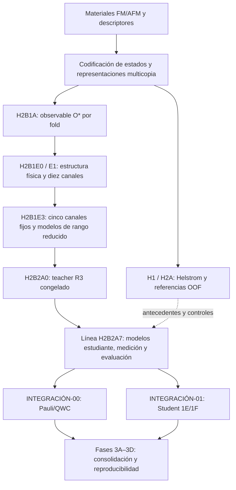

# Mapa científico del proyecto H2B2A7

> **Estado:** borrador documental inicial para revisión; no constituye una nueva certificación experimental.  
> **Fecha de preparación:** 16 de noviembre de 2026.  
> **Rama de base:** `develop`, commit `ed94433` (integración de PR #4).  
> **Rama de trabajo prevista:** `feature/h2b2a7-documentacion-cientifica`.  
> **Política:** conservar inmutables los notebooks históricos, checkpoints y reportes ya integrados; documentar separadamente hipótesis, pruebas numéricas y evaluación estadística.

## 1. Propósito del documento

Este mapa conecta las líneas de investigación que condujeron al desarrollo H2B2A7 para la clasificación **ferromagnético (FM) / antiferromagnético (AFM)** de materiales. Su propósito es permitir reconstruir **qué decisiones físicas y matemáticas se tomaron, qué experimentos las respaldan y qué afirmaciones estadísticas son admisibles**.

Este archivo **no sustituye** la historia de Git ni ordena los experimentos únicamente por su fecha. Los nombres H1, H2A, H2B1 y H2B2 identifican **familias o etapas experimentales**, no nuevas ramas Git que haya que crear.

### Preguntas rectoras

1. ¿Cómo se codifica la información de un material en estados cuánticos y qué restricciones introduce dicha codificación?
2. ¿Qué información de discriminación FM/AFM conserva cada reducción de estados, observables y canales?
3. ¿Qué relación existe entre el observable original, su descomposición física y los modelos de rango reducido?
4. ¿Qué reproducen realmente los estudiantes cuánticos y qué recursos lógicos se han medido o contabilizado?
5. ¿Qué resultados constituyen identidades algebraicas, verificaciones numéricas, evaluaciones exploratorias o pruebas confirmatorias?

## 2. Distinción entre líneas científicas y ramas Git

| Nivel | Elemento | Responsabilidad |
|---|---|---|
| Control de versiones | `main` | Base original conservada; no usarla como rama activa de documentación. |
| Control de versiones | `creacion-de-modelo` | Desarrollo histórico y manifiestos iniciales. |
| Integración | `develop` | Fuente integrada y revisada de las certificaciones y fases 3A–3D. |
| Trabajo experimental | `feature/pauli-qwc` | INTEGRACIÓN-00; replay Pauli/QWC. |
| Trabajo experimental | `feature/student-certification` | INTEGRACIÓN-01; reconstrucción Student 1E/1F. |
| Trabajo experimental | `feature/h2b2a7-consolidacion` | Fases de análisis 3A–3D. |
| Documentación | `feature/h2b2a7-documentacion-cientifica` | Documentos transversales y narrativa científica; crear PR hacia `develop` tras revisión. |

**Regla:** las líneas H1/H2A/H2B1/H2B2 se organizan dentro de `docs/investigacion/`; no reemplazan los worktrees o ramas existentes.

## 3. Mapa de dependencias científicas

**Precaución:** las flechas representan dependencias documentales o técnicas conocidas, **no** una demostración de independencia estadística ni una afirmación de que todos los experimentos fueron etapas obligatorias de un único entrenamiento. Verificar las aristas que dependen de archivos originales no integrados.

## 4. Líneas de investigación y contribuciones pendientes de redactar

### 4.1. Datos y representación cuántica

**Objeto de estudio.** Materiales etiquetados FM/AFM, descriptores composicionales y preparación de representaciones cuánticas. La auditoría histórica distingue conjuntos CORE de entrenamiento, validación y prueba y advierte que materiales con la misma composición pueden repetirse entre particiones convencionales.

**Pendiente:** establecer en un documento independiente la versión canónica del dataset, el método exacto de preparación de estados, las transformaciones supervisadas y no supervisadas, las reglas de agrupación por composición y el papel de atributos estructurales cuando se utilicen.

### 4.2. Referencias H1 / H2A y operadores Helstrom

**Resultado respaldado por auditorías posteriores (no incorporadas aún a Git):** el teacher H1 se calcula con ajuste por fold y sus cinco cachés coinciden con los correspondientes fragmentos OOF; el AUC OOF histórico combinado es aproximadamente `0.907406`. H2A3/H2A4 reutilizan el vector teacher correspondiente.

**Limitación:** la igualdad de cachés no autentica todos los índices de su ajuste original. La referencia global 3K/4F utiliza una base Helstrom previamente ajustada con etiquetas del conjunto completo de entrenamiento: sus AUC sobre ese conjunto **no son OOF**.

### 4.3. Línea H2B1: del observable a canales físicos

**Cadena de ejecución histórica reconstruida:** `O_FOLDS_H2B1A` → `OSTAR_FOLDS_H2B1E0` → `OSTAR_FOLDS_H2B1E1`. H2B1E1 descompone el operador heredado en diez canales efectivos sobre la estructura física examinada.

**Configuración fija C5 usada posteriormente por H2B1E3:** `II`, `IY`, `IZ`, `XY`, `ZZ`. El modelo R3 usa factores `F` y respuestas `G` derivados de estos cinco canales.

**Limitaciones:** el ajuste original de `O_FOLDS_H2B1A` sigue necesitando una referencia directa. Se inspeccionaron los 1023 subconjuntos no vacíos de diez canales; el código utiliza además AUC externos agregados para umbrales de complejidad. Por ello, la **elección global de C5 debe tratarse como exploratoria** si estuvo influida por esos resultados. La reconstrucción exacta del operador no acredita por sí sola generalización independiente.

### 4.4. Línea H2B2: teacher congelado, estudiantes y medición

H2B2A0 reutiliza un teacher R3 de H2B1E3. Para el fold piloto se documenta `outer_train = 5986`, `outer_hold = 1497`, `inner_train = 4788` e `inner_val = 1198`.

El ajuste ALS de R3 recibe factores y referencias del **entrenamiento externo**; no se observa uso directo del `outer_hold` en ese ajuste. Sin embargo, la validación interna del propio teacher R3 se realiza sobre muestras que ya contribuyeron a entrenarlo: su AUC de `inner_val` no es una validación independiente del teacher.

Los candidatos Student 1E/1F cuentan con replay de la implementación de observables `O_j = U_j† D_j U_j` y métricas históricas de `inner_val`. **No deben confundirse** esos resultados con los AUC retrospectivos del `outer_hold` de las otras rutas, ni presentarse como prueba nueva en hardware real.

## 5. Evidencia integrada hoy en `develop`

| Registro | Qué respalda | Qué no demuestra |
|---|---|---|
| [INTEGRACIÓN-00](../H2B2A7_INTEGRACION_00.md) | Replay de scores archivados para Teacher, SAFE y QWC, huellas y procedencia del código congelado | Evaluación independiente nueva, costo QPU integral o Student completamente reproducido |
| [INTEGRACIÓN-01](../H2B2A7_INTEGRACION_01.md) | 94/94 pruebas numéricas PASS y AUC histórico reconstruido sobre INNER VAL: Student 1E `0.913537480155041`, 1F `0.9159889583363131` | AUC confirmatorio, igualdad de cada score con un histórico no pareado, QPY histórico propio de 1F |
| [Fase 3A](../H2B2A7_FASE3A_PLAN.md) | Inventario de fuentes, comparabilidad y matriz de cobertura | Validez estadística por sí sola |
| [Fase 3B](../H2B2A7_FASE_3B_GUIA.md) | Comparaciones pareadas descriptivas dentro del mismo split; bootstrap condicionado | Uso de OUTER HOLD como nuevo test o comparación directa con Student INNER VAL |
| [Fase 3C](../H2B2A7_FASE_3C_GUIA.md) | Diferencias entre operadores, expectativas y scores Student | Generalización de clasificación o exactitud global de las matrices objetivo |
| [Fase 3C.3](../H2B2A7_FASE_3C3_GUIA.md) | Estabilidad e inversiones del ranking sobre INNER VAL | Garantía predictiva para materiales no observados |
| [Fase 3C.4](../H2B2A7_FASE_3C4_GUIA.md) | Inventario de recursos parciales de medición y circuitos | Costo completo por material o ventaja física de recursos |
| [Síntesis 3D](../../reports/H2B2A7_CONSOLIDACION/H2B2A7_3D_SINTESIS_20261113T184850523066Z/3D_INFORME.md) | 22/22 productos con SHA-256 verificado y unificación de reservas de 3A–3C4 | Reentrenamiento, QPU, validación independiente ni certificación integral de hardware |

### 5.1. Valores archivados: no mezclar protocolos

**OUTER HOLD previamente examinado, AUC retrospectivas de la síntesis 3D (`n=1497`):**

| Ruta archivada | AUC |
|---|---:|
| `TEACHER_S3_REFERENCIA_OUTER` | 0.92899819 |
| `SAFE_ideal` | 0.92508499 |
| `QWC24_ideal` | 0.91248910 |
| `QWC64_ideal` | 0.91779707 |

`TEACHER_S3_REFERENCIA_OUTER` no debe equipararse automáticamente a otros objetos denominados `teacher_R3` sin cotejo de procedencia.

**INNER VAL previamente examinado, Student 1E/1F (`n=1198`):** AUC `0.913537480155041` y `0.9159889583363131` respectivamente. Estos números proceden de otra partición y no permiten calcular una comparación pareada con las rutas OUTER.

**Nota de recursos:** la fase 3C.4 presenta presupuestos lógicos y parciales; no certifica el costo físico total ni una ventaja cuántica.

## 6. Auditorías de procedencia posteriores a la síntesis 3D

Las auditorías XIV–XXIV y los cuatro cierres dirigidos se ejecutaron **fuera del repositorio Git integrado**. Sus informes originales están actualmente en `Tesis5_CONSOLIDACION` como archivos sin seguimiento, y deben conservarse hasta revisar cuáles tienen valor como evidencia versionable.

Hallazgos documentales que deben trasladarse a una matriz específica de evidencia:

- Base 3K/4F: representación Helstrom global supervisada; métricas sobre sus datos de ajuste no son OOF.
- H1: ajustes por fold y cinco cachés OOF idénticos, con reserva sobre autenticación completa de entradas e índices.
- H2B1E1: trazabilidad inmediata de `O*` y descomposición física identificadas.
- C5: elección fija `II/IY/IZ/XY/ZZ`; tamaño de arquitectura explorado junto con resultados externos históricos.
- R3: ajuste ALS restringido al entrenamiento externo en el código examinado; dependencia metodológica de la construcción previa de `O*`.
- H2B2A0: `inner_val` no es validación independiente del teacher R3 ya entrenado.
- Composiciones no vistas: el análisis retrospectivo por grupos no sustituye un entrenamiento con *grouped CV* desde el comienzo.

**No subir automáticamente todos los `.txt`, `.py` o `.zip` locales**. Primero definir una matriz de procedencia y, de ser pertinente, una selección reducida de anexos, hashes y reportes. Evitar publicar rutas absolutas privadas, tokens o datos no autorizados.

## 7. Criterios para redactar afirmaciones en el trabajo de grado

| Tipo de afirmación | Prueba mínima exigida |
|---|---|
| Identidad algebraica | Derivación, hipótesis del modelo, verificación numérica y tolerancia declarada |
| Fidelidad numérica de implementación | Artefactos alineados, hashes, índices, operaciones equivalentes y error medido |
| Validación predictiva OOF | Preprocesamiento completo, ajuste y selección contenidos dentro de cada fold; cachés vinculados a índices |
| Generalización a composiciones inéditas | Agrupación por composición antes de particionar y ajuste completo dentro de folds disjuntos |
| Confirmación sobre datos nuevos | Protocolo y arquitectura predefinidos antes de inspeccionar las etiquetas del conjunto final |
| Ventaja QPU o de recursos | Ejecución física o presupuesto completo homogéneo, con preparación, medición, shots, compilación y lectura |

## 8. Trabajo inmediato en la rama de documentación

1. Revisar el presente mapa contra los documentos ya integrados y marcar cada dependencia como `VERIFICADA`, `PARCIAL` o `PENDIENTE`.
2. Crear `01_ARQUITECTURA_H2B2A7.md`, distinguiendo teacher, estudiantes, observables, estados y protocolos de evaluación.
3. Incorporar `03_MATRIZ_DE_EVIDENCIA.md` a partir de la matriz de auditoría local **después de revisar fuentes y nomenclatura**.
4. Preparar la narrativa de H1/H2A y H2B1 con referencias exactas a código histórico, sin introducir AUC en apartados que pretenden derivar identidades físicas.
5. Versionar cada documento en commits pequeños; revisar mediante PR hacia `develop`. No fusionar ni alterar retrospectivamente las fuentes experimentales.

## 9. Pendientes explícitos — no inventar su resolución

- [ ] Localizar el ajuste y la procedencia de `O_FOLDS_H2B1A`, incluyendo índices y etiquetas utilizados.
- [ ] Fijar una definición matemática completa y revisada de la **arquitectura final** H2B2A7, separada de las variantes exploratorias 1E/1F.
- [ ] Certificar la regla de agrupación de composiciones y predefinir una evaluación nueva si se desea reivindicar generalización a materiales inéditos.
- [ ] Documentar qué experimentos QPU históricos pertenecen al protocolo final y cuáles fueron exploratorios; evitar inferir ventaja cuántica.
- [ ] Reconciliar convenciones de notación, índices, nombres de *teacher* y versiones de datasets entre notebooks históricos e integraciones Git.

---

**Regla de mantenimiento:** editar este mapa solo cuando haya una referencia concreta a `docs/`, `reports/`, `experiments/`, `scripts/` o a un artefacto histórico autenticado. Las reservas metodológicas no se eliminan porque una métrica mejore o porque una identidad algebraica se verifique.
