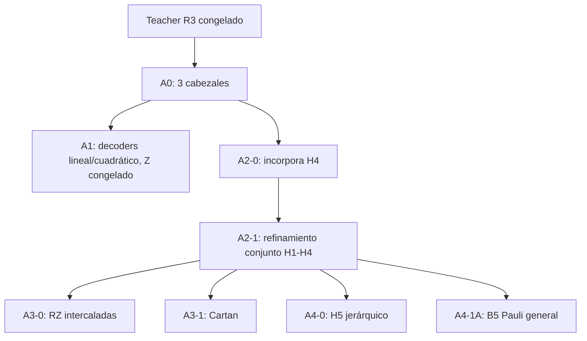

# H2B2A7 — Resultados históricos y auditorías independientes de H2B2A0–A4-1A

> **Estado:** borrador documental v0.1, 18 de noviembre de 2026; listo para revisión, **no integrado todavía en Git**.  
> **Base documental verificada:** `0493958d5bba55e791ec3f5d606cef7da5f888ff` de `feature/h2b2a7-documentacion-cientifica`.  
> **Alcance:** reconstrucciones retrospectivas, sin reentrenar, sin consultar etiquetas ni `OUTER HOLD` en los verificadores aquí considerados.  
> **Advertencia metodológica:** las AUC enumeradas son **registros históricos de `INNER VAL`**, no un test independiente nuevo. Los informes de auditoría prueban identidades numéricas y correspondencia con checkpoints, no ausencia general de filtración en toda la cadena creadora.

## 1. Propósito y documentos relacionados

Este informe sistematiza las decisiones y pruebas de **H2B2A0, A1, A2, A3, A4-0 y A4-1A**, sin confundir variantes exploratorias con el modelo final H2B2A7 o con los Student 1E/1F y las rutas SAFE/QWC documentadas en otras integraciones.

Documentos complementarios:

- [Mapa científico](00_MAPA_CIENTIFICO.md): dependencias entre familias y antecedentes.
- [Arquitectura y matemática](01_ARQUITECTURA_H2B2A7.md): estados, operadores, reducciones y definiciones.
- [Linaje experimental](02_LINEAJE_EXPERIMENTAL.md): motivaciones, bifurcaciones y decisiones.
- [Matriz de evidencia](03_MATRIZ_DE_EVIDENCIA.md): afirmaciones y fuente verificable (E01–E21 al momento del corte; E22–E27 propuestas en §9 de este informe).
- [Validación y limitaciones](04_VALIDACION_Y_LIMITACIONES.md): independencia estadística, selección retrospectiva y requisitos de confirmación.

La fuente primaria del tramo auditado es el notebook histórico `ContinuacionnuevaModelosdataset2.ipynb`, con checkpoints archivados bajo los prefijos `ARCH4FH2B2A*`. Este documento no reconstruye su ejecución cronológica completa; distingue **resultado guardado**, **código fuente inspeccionado** y **auditoría nueva no invasiva**.

## 2. Protocolo común y condiciones de interpretación

La base `PSI7_ALL_3S.npy` contiene 7.483 estados de siete qubits (amplitudes complejas de longitud 128). En el piloto utilizado para las auditorías:

| Partición | Cantidad | Alcance |
|---|---:|---|
| `OUTER TRAIN` | 5.986 | Conjunto anterior de ajuste del teacher R3 |
| `OUTER HOLD` | 1.497 | Conjunto externo históricamente examinado, no usado por estos verificadores |
| `INNER TRAIN` | 4.788 | Ajuste/desarrollo del estudiante y normalizadores |
| `INNER VAL` | 1.198 | Selección y diagnóstico histórico de variantes de estudiante |

Las auditorías comprobaron la disjunción por índice entre `INNER TRAIN` y `INNER VAL`, su pertenencia a `OUTER TRAIN` y la exclusión operativa de `OUTER HOLD`. **Esto no demuestra que el teacher R3 sea independiente de `INNER VAL`**: había sido ajustado anteriormente con `OUTER TRAIN`, que contiene esas mismas muestras. La elección histórica de `O★`, C5 y determinadas complejidades también estuvo informada por resultados externos previamente consultados. Véase [validación y limitaciones](04_VALIDACION_Y_LIMITACIONES.md).

Convenciones de evidencia utilizadas en la tabla y en los apartados:

- **RECONSTRUCCIÓN:** un cálculo nuevo sin etiquetas reproduce matrices, expectativas, función objetivo o puntuaciones archivadas.
- **CONTINUIDAD:** se comparan directamente parámetros y arrays de dos checkpoints.
- **HISTÓRICO:** una métrica de clasificación guardada en el notebook/CSV se consulta sin recalcular etiquetas.
- **PRUEBA LOCAL:** se examinan muestras o coordenadas; no equivale a recorrer exhaustivamente todos los parámetros, muestras o pasos históricos.
- **NO CERTIFICADO:** desempeño confirmatorio en grupos nuevos, tiempo QPU end-to-end, causalidad de la ganancia o superioridad estadística.

## 3. Panorama histórico de arquitecturas

| Etapa y modelo | Base inmediatamente utilizada | AUC histórica `INNER VAL` | Decisión respaldada por los registros |
|---|---|---:|---|
| **A0**: tres cabezales RY/RXX/RYY/RZZ y decodificador afín | Teacher R3 congelado | **0.838085158** | Punto de partida del estudiante variacional de seis qubits por cabezal |
| **A1**: mejor decoder lineal congelando Z | A0 | **0.839034856** | Un reajuste afín cambia poco la discriminación |
| **A1**: decoder cuadrático congelando Z | A0 | **0.842985254** | Mayor flexibilidad clásica aporta mejora moderada |
| **A2-0**: cuarto cabezal H4 optimizado incrementalmente | A0, tres cabezales congelados | **0.843357123** | Nueva dirección de medición no linealmente optimizada con los anteriores fijos |
| **A2-1**: refinamiento conjunto de cuatro cabezales | Mejor A2-0 | **0.846775462** | Mejor barrido 2; el barrido 3 no fue seleccionado |
| **A3-0**: RZ intercaladas | A2-1 | **0.846775462** | Mejor checkpoint = barrido 0, nuevos RZ en cero |
| **A3-1**: Cartan entre ramas | A2-1 | **0.847376175** | Pequeña ganancia en barrido 1 |
| **A4-0**: H5 jerárquico, `DECODER_ONLY` | A2-1, cuatro cabezales congelados | **0.847482014** | Mejor checkpoint = barrido 0; nuevas puertas sin optimizar |
| **A4-1A**: quinto observable Pauli arbitrario | A2-1, cuatro cabezales congelados | **0.939362387** | Gran incremento descriptivo al ampliar la familia del quinto observable |

**No interpretar las filas como una sucesión única de ganadores.** A1 modifica solo la lectura de A0; A3 y ambas ramas A4 parten de A2-1. Los modelos 1E/1F, SAFE y QWC siguen protocolos adicionales y no deben fundirse con esta tabla. La AUC registrada depende del conjunto y selección de desarrollo, no mide incertidumbre ni significación estadística.

### 3.1. Diagrama de dependencias de las ramas examinadas

## 4. H2B2A0 — Tres cabezales y objetivo de destilación

Se preparan estados reducidos de seis qubits `rho6` desde los estados originales `psi7`. Cada cabezal produce una expectativa real de la forma

$$
z_h(x;\theta_h)=\operatorname{Tr}\bigl[\rho_6(x)\,U_h(\theta_h)^\dagger Z_{r_h}U_h(\theta_h)\bigr],
\qquad r_h\in\{q_0,q_2,q_4\}.
$$

El diseño original utiliza seis RY y cinco bloques de tres rotaciones Pauli (RXX, RYY, RZZ), **21 parámetros nominales por cabezal** (63 en total), con una lectura afín de las tres expectativas. Un teacher R3 congelado proporciona tres componentes latentes y un score de referencia. El objetivo examinado es

$$
\mathcal L=\underbrace{\frac{\operatorname{MSE}(\widehat s,s_3)}{D_{\rm score}}}_{\mathcal L_{\rm score}}
+0.25\underbrace{\frac{\operatorname{MSE}_{\lambda}(\widehat{\boldsymbol t},\boldsymbol t)}{D_{\rm latent}}}_{\mathcal L_{\rm latent}}
+10^{-6}\|A\|_F^2,
$$

con `D_score = 0.002296306926438` y `D_latent = 0.002672843134841`, calculados en `INNER TRAIN` y congelados para las comparaciones. La convención exacta de la MSE latente ponderada debe mantenerse alineada con la celda histórica; no sustituirla por una MSE genérica sin pesos.

| Checkpoint | Objetivo TRAIN | Objetivo VAL |
|---|---:|---:|
| A0-4, barrido 3 | 0.762898490220 | 0.760178166262 |
| A0-6, barrido 8 | 0.682696806454 | 0.672004160259 |

**Certificaciones:** comparación de huellas; simulación independiente de los tres circuitos y reproducción de expectativas en 20 muestras TRAIN y 16 VAL por checkpoint (errores del orden de $10^{-8}$); reproducción del objetivo total en los 4.788 TRAIN y 1.198 VAL a partir de los checkpoints archivados. Se verificó la forma de Fourier de orden máximo dos del **objetivo cuadrático con la lectura afín congelada** para 15 coordenadas muestreadas: error máximo $8.882\times10^{-16}$.

**Conclusión limitada:** el circuito reproducido es compatible numéricamente con el historial y su pérdida; no se reprodujeron todos los barridos ni se demostró que la distilación logre igualar al teacher, ni que una AUC de desarrollo generalice a composiciones inéditas.

## 5. H2B2A1 — Lectura clásica congelando las características cuánticas

A1 mantuvo exactamente `theta`, `Z_train` y `Z_val` de A0; la comprobación de identidad dio diferencia máxima cero. Comparó siete ponderaciones latentes `alpha ∈ {0, 0.01, 0.05, 0.10, 0.25, 0.50, 1.00}` y dos familias de decodificación:

$$
\widehat{\boldsymbol t}_{\rm lineal}=B\boldsymbol z+\boldsymbol c,\qquad
\widehat{\boldsymbol t}_{\rm cuadratico}=B\phi(\boldsymbol z)+\boldsymbol c,
$$

$$
\phi(\boldsymbol z)=(z_1,z_2,z_3,z_1^2,z_2^2,z_3^2,z_1z_2,z_1z_3,z_2z_3).
$$

Los mejores checkpoints por AUC histórica fueron **lineal, alpha=0.01, AUC 0.839034856** y **cuadrático, alpha=0.05, AUC 0.842985254**. El modelo cuadrático con alpha=0 produjo RMSE relativo VAL ligeramente mejor que el seleccionado por AUC: **0.674905** frente a **0.676248**. La reconstrucción de objetivos y gradientes de ajuste dio normas infinitas de gradiente $1.158\times10^{-13}$ y $5.333\times10^{-14}$ para los decodificadores elegidos.

**Interpretación:** parte de la información disponible en las expectativas de A0 puede explotarse mejor clásicamente. No se demuestra que el circuito sea la única limitación ni que los coeficientes cuánticos estén globalmente optimizados. Los valores objetivos de alpha distintos no se comparan directamente como si fueran una misma función escalar.

## 6. H2B2A2 — Cuarto cabezal incremental y refinamiento conjunto

A2-0 incorporó H4 con raíz de medición $q_1$; los tres cabezales iniciales y sus expectativas se mantuvieron exactamente congelados. El nuevo cabezal contiene 21 parámetros nominales, aunque la última RZZ es inactiva para su lectura de Z: **20 coordenadas efectivas**.

| Checkpoint | Objetivo TRAIN | Objetivo VAL | RMSE relativo VAL | AUC histórica VAL |
|---|---:|---:|---:|---:|
| H4 incremental, barrido 4 | 0.649416640 | 0.647388090 | 0.683116463 | 0.843357123 |
| JOINT4, barrido 2 seleccionado | 0.622344084 | 0.631051410 | 0.673329601 | **0.846775462** |
| JOINT4, barrido 3 no elegido | 0.617583029 | 0.627120706 | 0.671149930 | 0.846592388 |

A2-1 parte del mejor H4 y refina cuatro cabezales (84 parámetros nominales, **80 coordenadas efectivas** en esta familia). La diferencia angular RMS respecto de H4 fue **0.135309 rad**. El barrido 3 mejoró el objetivo VAL y el RMSE relativo, pero tuvo una AUC histórica ligeramente inferior a la del barrido 2.

**Certificaciones:** continuidad exacta A0→A2-0→A2-1, identidad de los mejores checkpoints con los barridos guardados, reproducción de objetivos TRAIN/VAL y expectativas de los cuatro circuitos desde `PSI7` en muestras TRAIN/VAL (máximo error observado $3.523\times10^{-8}$); inactividad de RZZ terminal; 20 controles Fourier del objetivo compuesto con error máximo $6.661\times10^{-16}$.

**Resultado científico:** H4 aportó una dirección no redundante según los diagnósticos de subespacios y ablación históricos, con ganancia modesta de discriminación. Las ablaciones históricas se realizaron sobre el conjunto de desarrollo y no son estimaciones causales independientes.

## 7. H2B2A3 — Variaciones expresivas RZ y Cartan

Se estudiaron dos ampliaciones alternativas a partir del mismo A2-1, manteniendo congelados los **84 parámetros antiguos**.

**A3-0 (RZ intercaladas).** Incorpora tres RZ por cabezal (12 ángulos nuevos, 4×24 parámetros nominales). El mejor checkpoint fue el **barrido 0**, con todos los nuevos RZ en cero, idéntico a A2-1. Las AUC históricas de los barridos 0, 1, 2 fueron `0.846775462`, `0.846249124`, `0.845908720`.

**A3-1 (Cartan entre ramas).** Incorpora tres bloques Cartan por cabezal, cada uno con RXX/RYY/RZZ (36 ángulos nuevos, 4×30 parámetros nominales). El mejor checkpoint fue **barrido 1**, AUC histórica `0.847376175`, frente a `0.847276056` del barrido 2. En la reconstrucción del barrido 1 se obtuvo objetivo TRAIN `0.610520225996`, objetivo VAL calculado `0.632324440406` y RMSE relativo VAL `0.674627768`.

**Certificaciones:** identidad de base A2, nuevos ángulos cero anidan los circuitos anteriores, checkpoints y objetivos coincidentes donde existen columnas archivadas, reconstrucción independiente desde `PSI7` (máximo error en expectativas $2.729\times10^{-8}$), 16 controles Fourier (error global máximo $8.882\times10^{-16}$).

**Interpretación:** Cartan mejoró la AUC histórica en `0.000600712` frente a A2, pese a mostrar un error de destilación VAL algo mayor que A2. La ganancia no es demostración estadística de superioridad. En el historial Cartan **no** se archiva `val_objective`; el valor mostrado procede de reconstrucción y no debe describirse como cotejo contra CSV.

## 8. H2B2A4 — Dos vías alternativas para una quinta característica

### 8.1. A4-0: quinto cabezal jerárquico de seis qubits

Se añadió un cabezal de 24 parámetros nominales (**23 efectivos**, última RZZ terminal inactiva), dejando congelados los cuatro cabezales del A2-1. La inicialización se reprodujo con semilla histórica `4240`.

| Modelo H5 | Objetivo TRAIN | Objetivo VAL recalculado | RMSE relativo VAL | AUC histórica VAL |
|---|---:|---:|---:|---:|
| `DECODER_ONLY`, barrido 0 seleccionado | 0.619127381 | 0.627200139 | 0.673276470 | **0.847482014** |
| Barrido 1 | 0.611711011 | 0.622011229 | 0.673619545 | 0.846211937 |
| Barrido 2 | 0.604256835 | 0.613529340 | **0.670617008** | 0.847267474 |

El mejor checkpoint en AUC fue **solo reajustar el decodificador con las puertas de H5 en su inicialización**. Los barridos redujeron la pérdida y mejoraron el RMSE al final, pero ninguno superó la AUC inicial. La ganancia respecto de A2 fue `+0.000706552`, y **no se atribuye a un entrenamiento exitoso de las puertas del quinto circuito**.

**Certificaciones:** identidad del bloque antiguo, checkpoint seleccionado, objetivos registrados TRAIN y RMSE relativo VAL, simulación desde `PSI7` para 16 muestras TRAIN y 12 VAL de tres checkpoints (máximo error $5.107\times10^{-8}$), siete pruebas Fourier con máximo $3.331\times10^{-16}$. El historial no tiene columnas `val_objective` ni `train_relative_RMSE`: sus valores son diagnósticos reconstruidos, no comparaciones con CSV.

### 8.2. A4-1A: quinto observable hermítico arbitrario sobre seis qubits

Este es un experimento **diferente de H5 jerárquico**. Conserva cuatro cabezales variacionales de A2-1 y agrega una quinta característica basada en un observable hermítico general:

$$
B_5=\sum_{P\in\mathcal P_6\setminus\{I\}}\beta_P P,
\qquad z_5(x)=\operatorname{Tr}\bigl[\rho_6(x)B_5\bigr].
$$

La base de Pauli de seis qubits aporta **4^6-1 = 4095 coeficientes no identidad**. Aquí la expresión *rango uno* se refiere a la adición de una característica multiplicada por un vector de lectura latente, **no** al rango matricial del operador $B_5$.

**Resultado histórico:** `AUC INNER VAL = 0.9393623868300987`, frente a `0.8467754623339101` de A2-1; incremento `+0.09258692449618855`. Es una diferencia **exploratoria y no controlada por igualdad de recursos**, no una ventaja física demostrada. La selección histórica revisó 21 configuraciones FIT/TUNE, y escogió `lambda_beta=0.01`, `svd_start=0` con `AUC_TUNE=0.936091923`; la fuente declara FIT/TUNE dentro de INNER TRAIN y reajuste en INNER TRAIN, pero no se recuperaron índices individuales de FIT/TUNE que permitan comprobar independientemente ese aislamiento.

**Certificaciones algebraicas y numéricas:**

- El observable reconstruido es hermítico y sin traza. Su forma matricial es 64×64.
- La identidad $z_5=X_6[:,1:]\boldsymbol\beta$ reproduce las **4.788 filas TRAIN y 1.198 VAL** guardadas (máxima discrepancia por redondeo $2.776\times10^{-17}$).
- La reconstrucción independiente `PSI7→rho6→Pauli/B5` sobre 12 filas TRAIN y 8 VAL produce discrepancia máxima contra el checkpoint de $2.917\times10^{-8}$; la representación Pauli y la matricial discrepan como máximo $1.665\times10^{-16}$ en esas muestras.
- La transformación de escala del observable y la compensación correspondiente en el decodificador mantienen las puntuaciones (error máximo $2.776\times10^{-17}$), pero **cambian la penalización ridge**: no se afirma invariancia de toda la pérdida regularizada.
- El coeficiente de determinación lineal de $z_5$ explicado por los cuatro cabezales fue `R² TRAIN=0.009495` y `R² VAL=0.009767`: escasa redundancia **lineal**, sin demostrar ortogonalidad absoluta o ventaja causal.

La normalización $\|\boldsymbol\beta\|_2=1$ **no** implica espectro ±1. La matriz hermítica normalizada tiene espectro aproximadamente $[-2.31722036, 2.16332237]$, y por tanto no es directamente un observable de la forma $U^\dagger ZU$ con un único resultado binario por ejecución. Su coste de medición, agrupación de Pauli, shots y compilación no está determinado. Tampoco se certificó un óptimo global de la familia de 4095 términos.

### 8.3. Comparación científica admisible

El contraste entre A2/A3/H5 y A4-1A **sugiere** que los estados de seis qubits contienen información discriminativa cuya extracción se ve limitada por los observables variacionales ensayados. Esta hipótesis está motivada por resultados reproducidos numéricamente, pero una diferencia histórica de AUC por sí sola **no identifica causalmente la fuente del límite**: difieren la capacidad, la regularización, la selección de hiperparámetros y la complejidad de medición. Antes de reivindicar una arquitectura superior o realizable se requiere comparación predefinida, coste físico homogéneo y validación independiente.

## 9. Matriz breve de fuentes y evidencia propuesta para E22–E27

Estos identificadores **todavía no se incorporaron a `03_MATRIZ_DE_EVIDENCIA.md`**. Se proponen para la siguiente entrega documental, tras reconciliar las fuentes y huellas en la rama Git.

| ID propuesto | Afirmación que puede respaldarse | Informe de auditoría primaria | Límite explícito |
|---|---|---|---|
| E22 | A0: objetivos de checkpoints y simulación de tres circuitos | `AUDITORIA_INDEPENDIENTE_CIRCUITOS_A0.txt`; `AUDITORIA_A0_OBJETIVO_COMPLETO_FOURIER.txt` | Fourier parcial; teacher ajustado antes de `INNER VAL` |
| E23 | A1: Z congeladas, decodificadores estacionarios y métricas archivadas | `AUDITORIA_INDEPENDIENTE_H2B2A1.txt` | AUC solo histórica de `INNER VAL` |
| E24 | A2: H4 y JOINT4, continuidad y expectativas físicas | `AUDITORIA_H2B2A2_H4_JOINT4_V2.txt` | Simulación submuestreada; selección en `INNER VAL` |
| E25 | A3: anidamiento y checkpoints RZ/Cartan | `AUDITORIA_H2B2A3_RZ_CARTAN_V2.txt` | Algunas columnas de objetivo no archivadas |
| E26 | A4-0: H5 y selección `DECODER_ONLY` | `AUDITORIA_INDEPENDIENTE_H2B2A4_H5.txt` | No mejora atribuible al entrenamiento de nuevas puertas |
| E27 | A4-1A: Pauli 4095, operador hermítico y gauge | `AUDITORIA_A4_1A_RESULTADO.txt` | FIT/TUNE sin índices archivados; no coste QPU |

Las auditorías anteriores se ejecutaron fuera del repositorio Git y conservaron su propia trazabilidad SHA256 de entradas. Antes de integrar sus informes, revisar nombres completos, tamaños, hash de cada evidencia, rutas privadas y permisos de difusión. **No incluir datasets, checkpoints binarios ni scripts indiscriminadamente**.

## 10. Límites generales de la línea experimental

1. **Independencia estadística:** `INNER VAL` participa en decisiones de selección; el teacher R3 fue ajustado antes de esa división y `OUTER HOLD` fue consultado retrospectivamente en otras etapas del linaje. Reproducir métricas no convierte las muestras en un nuevo test.
2. **Generalización química:** divisiones por fila no acreditan por sí mismas extrapolación a composiciones no vistas. Requiere particiones agrupadas por composición con todo el pipeline supervisado ajustado dentro de los folds.
3. **Recursos físicos:** un observable hermítico general no equivale a un circuito $U^\dagger ZU$ de seis qubits y resultados ±1. Son necesarios presupuestos de preparación, compilación, circuitos/bases, shots, mitigación y lectura, comparados a igual objetivo predictivo.
4. **Reproducción parcial y completa:** una identidad matemática de Fourier demostrable estructuralmente no significa que se hayan recalculado todos los barridos; las simulaciones físicas auditadas son sobre muestras seleccionadas, salvo los scores/objetivos archivados revisados sobre todos los índices internos.
5. **Rango, capacidad y medición:** rango de la aproximación ALS R3, rango de un decodificador de características y rango matricial de un operador $B_5$ no son el mismo concepto.
6. **No confundir objetos:** Student 1E/1F, SAFE/QWC y las rutas A0–A4 tienen diferencias en observables, preparación y protocolos. Comparar AUC de `OUTER HOLD` con `INNER VAL` sin muestras alineadas es inválido.

## 11. Próxima revisión y alcance de corte

Este documento cubre **solo A0–A4-1A**. La extracción documental A4-1B/1C/1D ha reportado 32 fuentes y 21 artefactos, pero **la extracción por sí sola no certifica esos resultados**. Rangos 2/3, variantes posteriores, QPU y resultados 19X requieren sus propias referencias, protocolos y auditorías antes de incorporarse con el mismo nivel de respaldo.

**Regla para la tesis:** escribir por separado (i) identidad algebraica; (ii) fidelidad de implementación/checkpoint; (iii) métrica histórica exploratoria; (iv) inferencia estadística independiente y recursos físicos. Solo los dos primeros bloques han recibido certificaciones independientes nuevas en las auditorías sintetizadas aquí.
